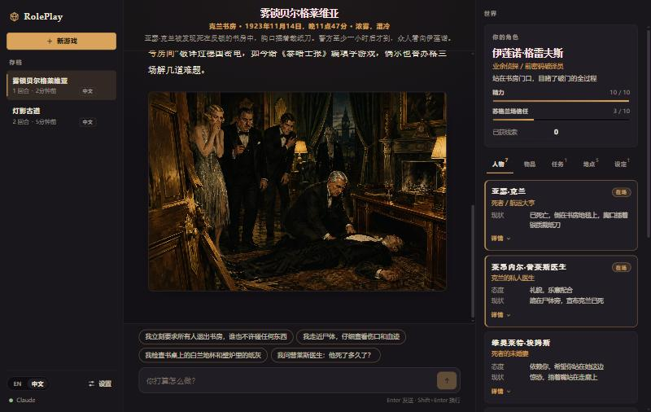
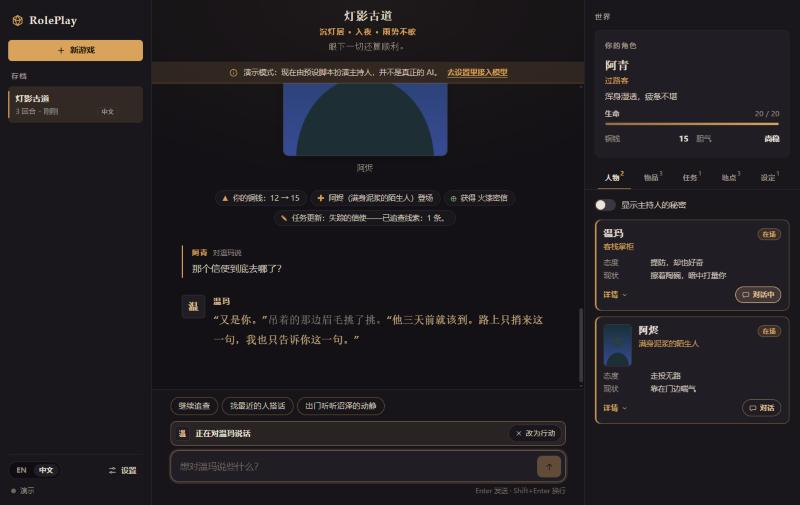
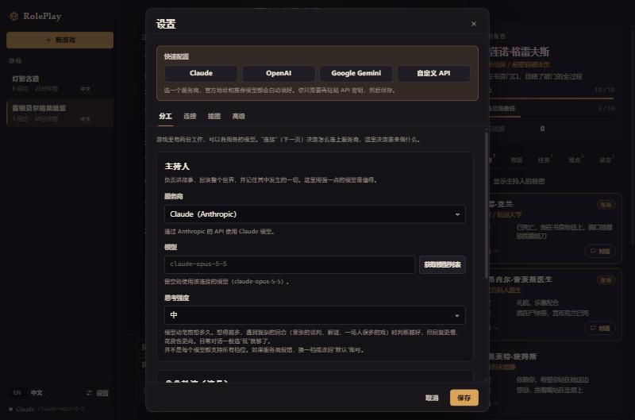

# RolePlay Platform

**English** | [简体中文](README.zh-CN.md)

An AI-driven role-play platform in the spirit of SillyTavern, built around one idea: **the model runs the world, the UI only shows it.**

You type what your character does. An AI game master narrates the result and, through tools, creates and updates everything else: characters, places, items, quests, stats, lore, time and weather. It can also paint the scene. There is no editor for any of that in the UI. The interface is a message log, a set of read-only world panels, and one input box.

You can also speak to any character in the scene, and they answer for themselves: in their own voice, from their own memories, knowing only what they witnessed or were told.

English and Chinese are both first-class: the interface, the game master's instructions, and the stories themselves.



## Quick start

Requires Node.js 20.12 or newer.

```bash
npm install
```

```bash
npm run dev
```

Open http://localhost:5173. With no API key configured the app starts in **demo mode**: a scripted game master plays a short fixed story, placeholder pictures included, so you can see everything work.

To play with a real model, open **Settings** and use **Quick setup**: one click selects Claude, OpenAI, Google Gemini or a custom API with sensible defaults, and the only thing left is to paste a key. Or put a key in `.env` (copy `.env.example`):

| In `.env` | Result |
| --- | --- |
| `ANTHROPIC_API_KEY` | Claude runs the game |
| `OPENAI_API_KEY` | OpenAI runs the game |
| `GEMINI_API_KEY` | Gemini runs the game |
| `RP_CUSTOM_BASE_URL` + `RP_CUSTOM_API_KEY` + `RP_CUSTOM_MODEL` | Your own gateway or any OpenAI-compatible service runs the game |
| several | The first in that order runs the game. With an OpenAI key present, switch illustrations on in Settings and OpenAI paints it |

| Command | What it does |
| --- | --- |
| `npm run dev` | Server on :8787 and web app on :5173, both reloading on change |
| `npm run build` then `npm start` | Builds the web app and serves everything from the server on :8787 |
| `npm test` | Engine and provider tests (no network, no key) |
| `npm run typecheck` | Type-checks every package |

## How it works

```
 player action
      │
      ▼
┌──────────────┐  instructions + story so far + world state (JSON)  ┌───────────────┐
│  Game engine │ ─────────────────────────────────────────────────▶ │  Game master  │
│   (server)   │ ◀───────────────────────────────────────────────── │   (the LLM)   │
└──────┬───────┘      tool calls: roll_dice, narrate, record        └───────────────┘
       │ validates and applies them, records what changed, has pictures painted
       ▼
   world state ──▶ streamed to the UI: narration, world events, pictures, new state
```

### The game master's tools

Everything the game master does goes through three tools.

| Tool | Purpose |
| --- | --- |
| `roll_dice` | Decides an uncertain outcome. The result goes back to the model and is shown to the player. |
| `narrate` | Tells the player what happens. This is the only prose the player reads, and it streams to the screen while the model is still writing it. |
| `record` | Everything the turn changed, in one call: the world's title, premise and art style; places; characters, their free-form stats and their minds; items; quests; lore (hidden entries are the game master's private notes); removals; the scene (location, time, weather); what each character will remember; pictures to paint; suggested next actions. It ends the turn. |

A turn is `narrate` + `record`, preceded by `roll_dice` when something is uncertain. Stats are not predefined: the game master invents the system that fits the genre (HP and gold, sanity, a cultivation realm).

Why three tools and not one per kind of change: some models send several tool calls in one response and others only ever send one. With a tool per change, the second kind needs a round trip for every character and item; with `record`, a whole turn is one response for the first kind and two for the second. And why narration is a tool rather than the model's plain reply: text written next to tool calls is not delivered verbatim by the newest Claude models, and as a tool input it can be streamed first, so the player is reading within a few seconds while the record is still being written.

Three more consequences of the design:

- **The world state is the memory.** Every turn is rebuilt from the world state and a transcript, not from the previous API exchange. Old turns can scroll out of the context window without the model losing track of who exists or what the player carries.
- **Events are data, not prose.** The server never writes player-facing sentences about world changes; it emits typed events ("Mara joined", "HP 20 → 14") and the UI words them in the interface language.
- **Each entry stands alone.** `record` validates and applies its entries one by one. A malformed character does not throw away the rest; the model is told exactly which entry was rejected and resends only that.

### Characters who speak for themselves

The game master knows everything, which makes it a poor actor: a character played from an all-seeing context leaks what they could not know, and every voice drifts toward the narrator's. So when you speak to a character directly, a separate model call plays that one character.

- **A mind of their own.** Each character has a voice (how they speak, with sample lines), goals, secrets, and a stream of memories. All of it is hidden from the player, like hidden lore.
- **Memory is knowledge.** Every turn the game master records what each witness will remember, from that character's point of view. A character who was not there gets no memory and does not know it happened, unless somebody tells them later. Hearsay is marked with who said it, and may be wrong.
- **They are shown only what they have.** The actor's prompt contains who the character is, the memories that come to mind, what they can perceive (the place, the hour, who else is in the room and what those people are visibly doing), and common knowledge. The game master's notes, other characters' secrets and events they missed are not marked secret; they are simply not there. A model cannot leak what it was never shown.
- **What comes to mind.** A character may hold hundreds of memories and a prompt a dozen. Recall weighs how recent a memory is, how much it mattered and whether it concerns who is present; and being asked about something brings back memories of it however old, so "what's in the cellar?" recalls the cellar.
- **Talking changes minds; the game master keeps the world.** The character answers, remembers the exchange in their own words, and may feel differently about you afterwards. Small talk costs one fast call and nothing else. When the exchange changes something, because the character does something (hands over a key, calls the guards, walks out), promises something, or tells you something that matters to what you are after, the character says so and the game master is brought in: it narrates anything that now happens, and records what changed, so the quest log, lore and scene keep up with the conversation.

The "Show the game master's secrets" switch in the Characters tab reveals each character's voice, goals, secrets and memories. That view is how you check whether characters are behaving believably.



### Illustrations

Painting is a separate service from the game master, so any model can tell the story while an image model draws it: Claude writes, OpenAI paints. When illustrations are on, `record` gains a `pictures` section. The game master writes each picture's prompt, the world's art style is appended so pictures share a look, and the engine paints in the background while the turn carries on. A picture of a character, place or item also becomes its portrait in the world panels. At most two pictures per turn.

## Project layout

```
packages/shared      The contract: world model, messages, API and settings types (no runtime deps)
apps/server          Game engine + HTTP API (Hono)
  src/engine           world.ts      world operations, the only code that changes state
                       tools.ts      the three tools: schemas (zod) and handlers
                       gameMaster.ts the turn loop: story turns and conversations
                       context.ts    what the game master sees each turn
                       actor.ts      a character answering for themselves, and what they are shown
                       memory.ts     which memories come to mind
                       prompts/      game master and actor instructions, one file per language
  src/llm              provider interface + Claude, OpenAI (Responses), Gemini and custom APIs (Chat Completions), mock
  src/images           painter interface + OpenAI Images and a free placeholder painter
  src/store            JSON-file persistence for sessions, settings and pictures
apps/web             React UI: message log, world panels, composer, i18n (en / zh)
```

## AI settings

Settings are built from three ideas.

**Connections** are how a provider is reached: an endpoint, a key, and a default model.

| Connection | Notes |
| --- | --- |
| **Claude (Anthropic)** | Official SDK, streaming, prompt caching. Defaults to `claude-opus-5-5`. On Anthropic's own endpoint, a request the model declines is retried on its default fallback model. |
| **OpenAI** | Driven through the Responses API, which is where current OpenAI models combine reasoning with tools. Defaults to `gpt-6.1-sol`. Nothing is stored on OpenAI's side. |
| **Google Gemini** | Through Google's OpenAI-compatible endpoint. Defaults to `gemini-3.8-flash`. The signatures Gemini attaches to its tool calls are sent back as it requires. |
| **Custom API** | Any service that speaks OpenAI Chat Completions with tool calling: a company gateway (LiteLLM, One API), DeepSeek, OpenRouter, a local Ollama. You give the base URL, key and model. |
| **Demo** | Scripted, offline, free. Used for demo mode, development and tests. |

**Roles** are the jobs models do. The *game master* tells the story and keeps the world; the *actor* speaks for one character at a time. Each role picks a connection, a model and a thinking effort, so the story can run on a strong model while characters answer in a second or two on a faster, cheaper one. By default the actor follows the game master.

**Thinking effort** is how hard a model reasons before it writes. More effort gives better judgement on complicated turns and costs more time and money; low is right for quick dialogue. Each provider has its own levels (Claude: low to max; OpenAI: none to xhigh; Gemini: none to high) and the form only offers the ones that provider has. "Default" sends nothing and lets the model decide.

**Advanced** settings shape what any model is given and may return:

| Setting | What it does |
| --- | --- |
| Max output length | Upper bound on one response, in tokens. Empty leaves it to the provider. |
| Temperature | How freely the model words things. Only sent to Gemini and custom endpoints; current Claude and OpenAI reasoning models reject it. |
| Story memory | How many past turns the game master rereads each turn. More keeps long stories consistent and costs more per turn. |
| Character memory | How many memories a character has in mind when they speak. |

Illustrations are configured separately (OpenAI Images API, or a server that mirrors it; `gpt-image-2.5-flare` at low quality by default; each picture is billed by the image provider).



Everything can be set in the Settings dialog (saved to `data/settings.json`) or with environment variables (see `.env.example`); what is saved in the app takes precedence. **Fetch models** lists what a key can actually use.

API keys stay on the server and are never sent back to the browser. A key from the environment is only ever sent to the endpoint the environment names for it, never to a different base URL typed into the app. The server listens on `127.0.0.1` by default.

Adding a provider means implementing two small interfaces in `apps/server/src/llm/types.ts`; the turn loop and game rules are provider-independent.

## Languages

- **Interface language** (EN / 中文) is a toggle in the app and only affects the chrome.
- **Story language** is chosen per game. It selects the game master's instruction set (`apps/server/src/engine/prompts/en.ts` or `zh.ts`), so the model is instructed in the language it writes in.

To add a language: add it to `LOCALES` in `packages/shared/src/world.ts`, add a prompt pack on the server and a locale file in `apps/web/src/i18n/locales/`. The compiler points at whatever is missing.

## HTTP API

```
GET    /api/settings                 current settings (no keys)
PUT    /api/settings                 update roles, connections, keys, generation, illustrations
GET    /api/settings/models?target=  models the saved key can use (anthropic | openai | gemini | custom | image)
GET    /api/sessions                 saved games
POST   /api/sessions                 new game { language, premise?, playerName?, playerConcept? }
GET    /api/sessions/:id             full session: world + messages
DELETE /api/sessions/:id
POST   /api/sessions/:id/turns       → Server-Sent Events. One of:
                                       { kind: "start" }                       the opening scene
                                       { kind: "action", text }                something you do
                                       { kind: "talk", characterId, text }     something you say to a character present
GET    /api/images/:sessionId/:file  a painted picture
```

The event stream and every payload type are documented in `packages/shared/src/api.ts`.

## Roadmap

- A living world: characters who pursue their goals off-screen, news that spreads between people who share a place, characters who start conversations themselves
- Memory summaries for long games, so a character's early history condenses instead of crowding out
- Automated believability tests: plant a secret and try to extract it, tell a fact and ask for it thirty turns later, change the world and check the answer changes
- More ways to play: companion chat built around one character, group scenes where characters talk to each other, an observer mode where the world runs itself
- Regenerate / undo a turn (per-turn world snapshots)
- Import SillyTavern character cards and world info as a starting world
- Let the player hand the game master a picture (vision input)
- Multiple player characters in one world
