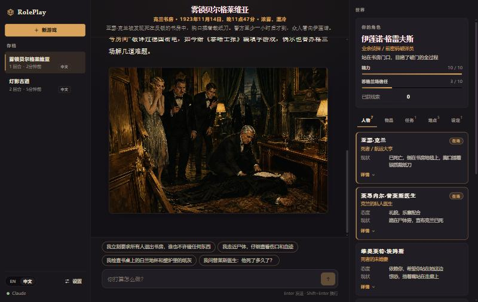
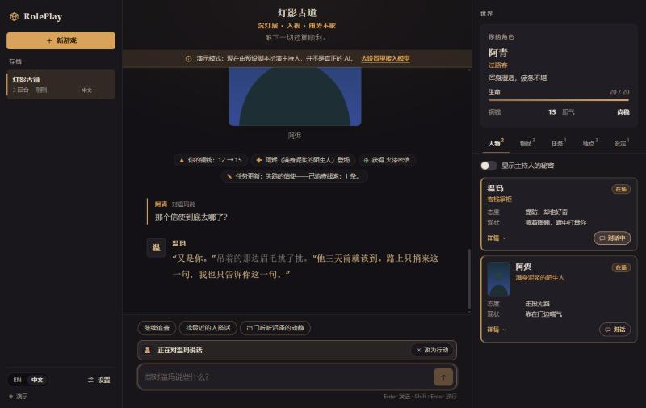
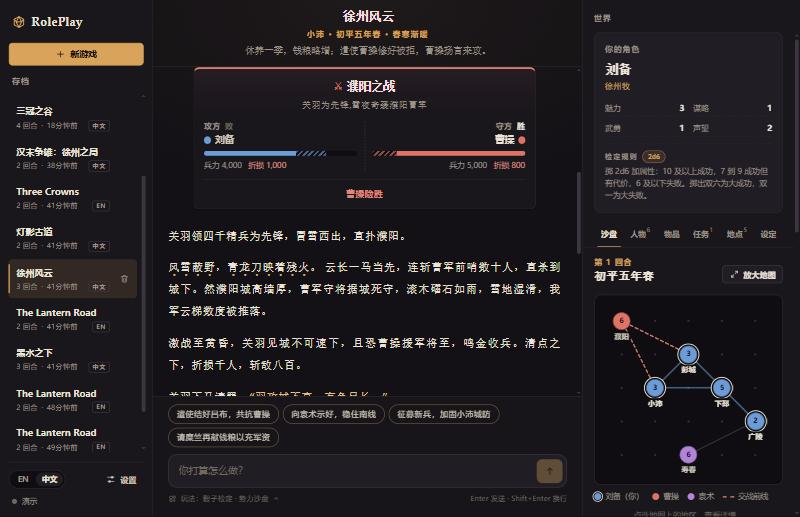
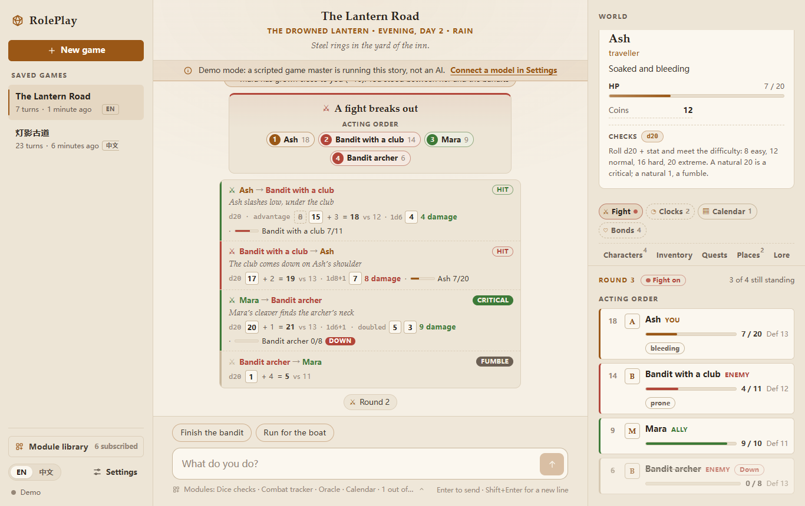
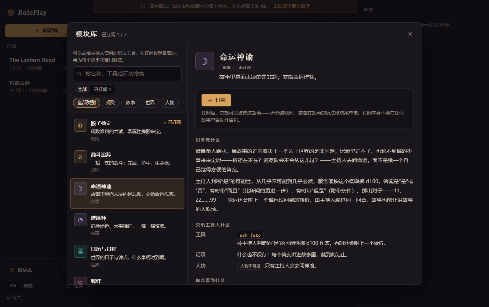
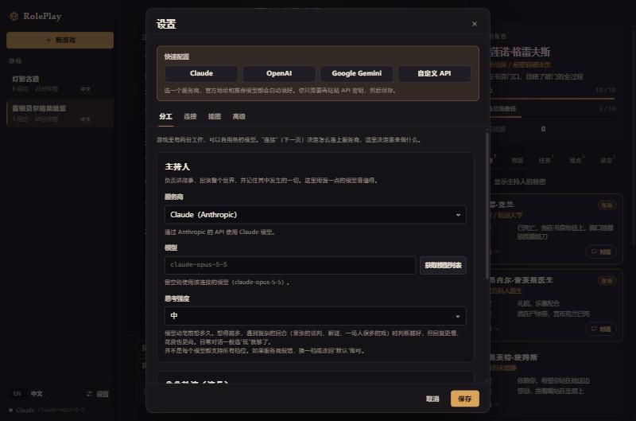

# RolePlay 角色扮演平台

[English](README.md) | **简体中文**

一个由 AI 驱动的角色扮演平台，思路上接近 SillyTavern，但围绕一个核心理念构建：**世界交给模型来运转，界面只负责展示。**

你只需要输入自己的角色做了什么。AI 主持人（GM）负责叙述结果，并通过工具创建和更新其余的一切：人物、地点、物品、任务、属性、设定、时间与天气，还可以为场景作画。界面里没有任何用来手动编辑这些内容的入口——它只有一份消息记录、一组只读的世界面板，以及一个输入框。

你还可以直接对场景里的任何人物说话，由他本人作答：用他自己的口吻，凭他自己的记忆，只知道他亲眼所见或听人说起的事。

中文和英文都是一等公民：界面、给主持人的指令，以及故事本身。



## 快速开始

需要 Node.js 20.12 或更高版本。

```bash
npm install
```

```bash
npm run dev
```

打开 http://localhost:5173 。没有配置 API Key 时，应用会以**演示模式**启动：由一个按剧本运行的主持人带你走一小段固定剧情，连占位插图也有，方便先看看整体效果。

想接入真实模型，打开**设置**，使用**快速配置**：点一下即可选好 Claude、OpenAI、Google Gemini 或自定义 API 及推荐的默认值，剩下只需要粘贴密钥。也可以把密钥写进 `.env`（由 `.env.example` 复制而来）：

| `.env` 中填写 | 效果 |
| --- | --- |
| `ANTHROPIC_API_KEY` | 由 Claude 主持游戏 |
| `OPENAI_API_KEY` | 由 OpenAI 主持游戏 |
| `GEMINI_API_KEY` | 由 Gemini 主持游戏 |
| `RP_CUSTOM_BASE_URL` + `RP_CUSTOM_API_KEY` + `RP_CUSTOM_MODEL` | 由你自己的网关或任何 OpenAI 兼容服务主持游戏 |
| 填了多个 | 按上面的顺序，第一个有密钥的来主持。有 OpenAI 密钥时，在设置里打开插图即可由 OpenAI 作画 |

| 命令 | 作用 |
| --- | --- |
| `npm run dev` | 启动服务端（:8787）和网页端（:5173），修改后自动重载 |
| `npm run build` 然后 `npm start` | 构建网页端，由服务端在 :8787 统一提供 |
| `npm test` | 引擎与模型接入层的测试（不联网，不需要 Key） |
| `npm run typecheck` | 对所有包做类型检查 |

## 工作原理

```
   玩家行动
      │
      ▼
┌──────────────┐     指令 + 已有剧情 + 世界状态（JSON）      ┌───────────────┐
│   游戏引擎    │ ─────────────────────────────────────────▶ │    主持人      │
│  （服务端）   │ ◀───────────────────────────────────────── │  （大模型）    │
└──────┬───────┘   工具调用：narrate、record、模块工具       └───────────────┘
       │ 校验并应用这些调用，记录发生了哪些变化，安排作画
       ▼
    世界状态 ──▶ 流式推送到界面：叙述、世界事件、插图、最新状态
```

### 主持人的工具

主持人做的每一件事，都通过工具完成。其中两个始终都在；玩法模块（见下文）会再添上各自的工具。

| 工具 | 用途 |
| --- | --- |
| `narrate` | 向玩家讲述发生了什么。这是玩家唯一能读到的文字，模型还在写的时候就已经流式显示在屏幕上。 |
| `record` | 一次调用记录本回合的全部变化：世界的标题、背景和画风；地点；人物、其自由定义的属性及其心智；物品；任务；设定（隐藏条目是主持人的私人笔记）；移除；场景（地点、时间、天气）；每个人物会记住的事；要画的插图；给玩家的下一步建议。它标志着回合结束。 |

一个回合就是 `narrate` + `record`；遇到不该由讲故事的人拍板的事（骰子掷出几点、一场仗谁输谁赢），前面再加一次模块工具的调用。属性不是预先定义好的：主持人会按题材设计相应的规则（生命值与金币、理智值、修仙境界）。

为什么只有一个 `record`，而不是每种变化一个工具：有的模型会在一次回复里发出多个工具调用，有的模型一次只发一个。如果每种变化一个工具，后一类模型每新增一个人物、一件物品都要多一次往返；有了 `record`，前一类模型一次回复就能走完一个回合，后一类也只需两次。为什么叙述也是工具，而不是模型的普通回复：最新的 Claude 模型不会把工具调用旁边的文字原样返回；而作为工具输入，它可以排在最前面流式输出，玩家几秒内就能开始读，记录同时在后面写入。

这个设计还带来三点：

- **世界状态就是记忆。** 每个回合都从世界状态和剧情文本重新构建，而不是沿用上一次的 API 对话。较早的回合可以移出上下文窗口，模型也不会忘记有哪些人物、玩家身上带着什么。
- **事件是数据，不是文案。** 服务端不会生成面向玩家的“世界变化”句子，它只发出带类型的事件（“温玛登场”“生命 20 → 14”），由界面按当前界面语言来措辞。
- **每个条目各自成立。** `record` 逐条校验、逐条应用。一个写错的人物不会让其余内容作废；模型会被明确告知是哪一条被拒绝，只需重发那一条。

### 亲自开口的人物

主持人无所不知，所以它当不好演员：由一个全知的上下文来演的人物，会说出自己不可能知道的事，而且人人的口吻都会向旁白靠拢。因此，当你直接对某个人物说话时，会有一次单独的模型调用专门扮演这一个人物。

- **有自己的心智。** 每个人物都有口吻（怎么说话，附示例台词）、目标、秘密，以及一连串记忆。这些都不向玩家展示，和隐藏设定一样。
- **记忆就是所知。** 每个回合，主持人都会从每位目击者的视角，记录他会记住什么。不在场的人没有这段记忆，也就不知道这件事发生过——除非之后有人告诉他。听来的事会标明是谁说的，而且可能是错的。
- **只给他看他有的东西。** 演员拿到的内容只有：这个人物是谁，此刻浮上心头的记忆，他能感知到的（地点、时辰、屋里还有谁、那些人看上去在做什么），以及人尽皆知的常识。主持人的笔记、别人的秘密、他错过的事，并不是“标成机密”，而是根本不在其中。模型不可能泄露它从未看到过的东西。
- **什么会浮上心头。** 一个人物可能有几百条记忆，而一次提示只放得下十来条。回忆时会权衡：这段记忆有多近、有多重要、是否与在场的人有关；而一旦被问起某件事，与它有关的记忆不论多久远都会被想起——问一句“地窖里有什么”，他就会想起地窖。
- **交谈改变人心，世界由主持人来记。** 人物作答，用自己的话记下这次交谈，对你的看法也可能随之改变。闲聊只需一次快速调用，别无其他。而当这次交谈带来了变化——人物做了什么（交出钥匙、喊来守卫、转身离开）、答应了什么，或者告诉了你一件对你所求之事很重要的事——人物会说明这一点，并请主持人出面：叙述接下来发生的事，记录变化，让任务、设定和场景跟上对话。

人物页签里的“显示主持人的秘密”开关，可以看到每个人物的口吻、目标、秘密和记忆。要检查人物的表现是否可信，就看这里。



### 插图

作画和主持是两项独立的服务，所以任何模型都可以讲故事，再由图像模型来画：Claude 写，OpenAI 画。打开插图后，`record` 会多出一个 `pictures` 部分。每张图的提示词由主持人撰写，引擎会附上世界的画风让插图风格统一，并在后台作画，回合照常进行。人物、地点、物品的图还会成为它在世界面板里的立绘。每回合最多两张。

### 玩法模块

不同的玩法需要不同的工具：跑团要有骰子，人物卡上的数字要算数；扮演一个国家，要有地图和账本。一个模块就是这样一件工具，而且是交给 AI 来用的，不是交给玩家的。每个模块给主持人四样东西：

- **一个由服务端算出结果的工具**，用于讲故事的人不该随口决定的事：由服务端掷骰、清点、判定，主持人再按结果讲述（只负责记账的模块没有工具）；
- **`record` 里的一节**，用来记这个模块要保存的内容，记账不会多出一次往返；
- **一段说明**，写明这个模块用于什么场合、怎么用，并入给主持人的指令；
- **世界里的一份状态**（`world.modules`），界面把它画成面板，每回合也会交还给主持人。

| 模块 | 用于 | 主持人得到什么 | 玩家看到什么 |
| --- | --- | --- | --- |
| `dice` 骰子检定 | 跑团式玩法 | `check`：按本故事的骰子规则（d20 + 属性对抗难度、d100 不超过属性、2d6 + 属性）检定人物卡上的属性并判定结果。`roll_dice`：其余情况掷普通骰子。 | 每一次掷骰都出现在剧情记录里，带着骰面、目标值和结果。 |
| `combat` 战斗追踪 | 一招一式打出来的战斗 | `fight`：结算一轮攻击（d20 命中对抗防御、伤害骰，生命直接从人物卡上扣）。谁在场、先攻顺序、身上的状态记在 record 里。 | 先攻顺序与血条的追踪面板；每次攻击一张卡片。 |
| `oracle` 命运神谕 | 意外与转折 | `ask_fate`：把关于世界的是非问题交给概率，回答是或否，有时带“而且”或“但是”，偶尔附上一个要编进剧情的转折。 | 问题、掷骰和答案。 |
| `clocks` 进度钟 | 步步逼近的危险、长期事务 | 记在 record 里的进度钟：没有工具，所以不多一次往返。 | 分格的圆盘，随着事情逼近一格格填满。 |
| `calendar` 日历与日程 | 期限、行程、约定 | `pass_time`：推进世界的时钟，并报告这段时间里有什么到期了，包括玩家并不知道的事。 | 第几天、几点，以及日程上有什么。 |
| `bonds` 羁绊 | 同伴、恋情、权谋 | 每个人物与玩家的亲疏数值，由 record 调整，人物亲自开口时也会自己调整。 | 每段关系走到了哪一步，是什么推动的。 |
| `sandbox` 势力沙盘 | 各方势力争夺地盘 | 势力、地区、家底与关系组成的沙盘。`simulate` 负责裁定战斗（兵力、形势，加上双方各 2d6 的运气）和推进回合。 | 谁占着哪里的地图、各方的账本、随时发生的战斗。 |





#### 模块库

模块要先订阅，就像编辑器里安装扩展一样。**没有订阅的模块，永远不会提供给主持人**：把选模块交给 AI 时不会，旧存档里曾经用过它也不会。全新安装只订阅了骰子。模块库会列出每个模块给 AI 什么、你会看到什么，以及大致的代价：开启它的故事，每次请求会多出多少 token 的说明和 schema。



在已订阅的模块里，每个故事有自己的一套。开始游戏时你可以自己选，也可以交给 AI：开场回合会把所有已订阅的模块都提供给它，由它在记录里写明这个故事要用哪些（潜入盗信会留下骰子、进度钟和神谕；两个人结伴同行的故事会留下羁绊；两者都不会留沙盘）。故事进行中可以随时开关。关掉的或者取消订阅的模块不花任何代价，它的数据留在故事里，等它回来。

一个模块包括：`apps/server/src/engine/modules/` 下的一个文件（工具、record 的一节、中英文说明），`packages/shared` 里的类型与事件，以及界面里的视图。回合循环、模型接入层和提示词都不用改。

## 项目结构

```
packages/shared      前后端契约：世界模型、消息、API 与设置的类型（无运行时依赖）
apps/server          游戏引擎 + HTTP API（Hono）
  src/engine           world.ts      世界操作，唯一会修改状态的代码
                       tools.ts      narrate 与 record：schema（zod）与处理函数
                       modules/      玩法模块：骰子、战斗、神谕、进度钟、日历、羁绊、沙盘
                       gameMaster.ts 回合循环：剧情回合与对话
                       context.ts    每回合主持人看到的内容
                       actor.ts      人物亲自作答，以及给他看的内容
                       memory.ts     哪些记忆会浮上心头
                       prompts/      主持人与演员的指令，每种语言一个文件
  src/llm              模型接入层接口 + Claude、OpenAI（Responses）、Gemini 与自定义 API（Chat Completions）、Mock
  src/images           作画接口 + OpenAI Images 与免费的占位画师
  src/store            会话、设置与插图的文件持久化
apps/web             React 界面：消息记录、世界面板、输入框、国际化（en / zh）
```

## AI 设置

设置由三个概念组成。

**连接**决定怎么连上一家服务商：接口地址、密钥，以及默认模型。

| 连接 | 说明 |
| --- | --- |
| **Claude（Anthropic）** | 官方 SDK，流式输出，提示词缓存。默认 `claude-opus-5-5`。直连 Anthropic 官方接口时，被模型拒绝的请求会自动改由其默认的后备模型重试。 |
| **OpenAI** | 走 Responses API——当前的 OpenAI 模型只有在这里才能同时使用推理和工具。默认 `gpt-6.1-sol`。不在 OpenAI 一侧保存任何内容。 |
| **Google Gemini** | 通过 Google 的 OpenAI 兼容接口访问。默认 `gemini-3.8-flash`。Gemini 附在工具调用上的签名会按它的要求原样回传。 |
| **自定义 API** | 任何支持带工具调用的 OpenAI Chat Completions 的服务：公司内部网关（LiteLLM、One API）、DeepSeek、OpenRouter、本地的 Ollama。填上接口地址、密钥和模型即可。 |
| **演示** | 按剧本运行，完全离线，不花钱。用于演示模式、开发和测试。 |

**分工**是模型在游戏里承担的工作。*主持人*负责讲故事、维护世界；*演员*每次替一个人物开口。每份工作各自选择连接、模型和思考强度，所以故事可以交给强的模型，人物则用更快、更便宜的模型一两秒就答上话。默认情况下演员跟随主持人。

**思考强度**是模型动笔之前推理得有多深。强度越高，复杂回合里的判断越好，也越慢、越贵；日常对话用“低”就够了。每家服务商的档位不一样（Claude：low 到 max；OpenAI：none 到 xhigh；Gemini：none 到 high），表单里只会列出该服务商支持的档位。“默认”表示什么都不传，交给模型自己决定。

**高级**设置决定交给模型多少内容、允许它写多长：

| 设置 | 作用 |
| --- | --- |
| 最大输出长度 | 单次回复的上限，单位是 token。留空则由服务商决定。 |
| 温度 | 措辞的放开程度。只发给 Gemini 和自定义 API；当前的 Claude 和 OpenAI 推理模型不接受这个参数。 |
| 剧情记忆 | 主持人每个回合重读多少个过去的回合。越多，长篇越连贯，每回合也越贵。 |
| 角色记忆 | 人物开口时心里想起多少条记忆。 |

插图单独配置（OpenAI Images API 或与之兼容的服务；默认 `gpt-image-2.5-flare`、低画质；每张图由图像服务单独计费）。



以上都可以在应用的设置对话框里配置（保存在 `data/settings.json`），也可以用环境变量（见 `.env.example`）；应用内保存的设置优先。**获取模型列表**会列出密钥实际可用的模型。

API Key 只保存在服务端，不会回传给浏览器。来自环境变量的密钥只会发往环境变量为它指定的接口地址，绝不会发给你在应用里另外填写的其他地址。服务端默认只监听 `127.0.0.1`。

接入新的模型服务，只需实现 `apps/server/src/llm/types.ts` 里的两个小接口；回合循环和游戏规则与具体服务无关。

## 语言

- **界面语言**（EN / 中文）在应用内随时切换，只影响界面文字。
- **故事语言**在每局游戏开始时选择。它决定使用哪一套主持人指令（`apps/server/src/engine/prompts/en.ts` 或 `zh.ts`），也就是说，模型用哪种语言写作，就用哪种语言接受指令。

新增一种语言：在 `packages/shared/src/world.ts` 的 `LOCALES` 中加入它，在服务端加一份指令文件，在 `apps/web/src/i18n/locales/` 加一份界面文案。缺了什么，编译器会指出来。

## HTTP API

```
GET    /api/settings                 当前设置（不含 Key）
PUT    /api/settings                 更新分工、连接、Key、生成参数、插图、模块订阅
GET    /api/modules                  模块库：每个模块给 AI 什么、代价多少
GET    /api/settings/models?target=  已保存的 Key 可用的模型（anthropic | openai | gemini | custom | image）
GET    /api/sessions                 存档列表
POST   /api/sessions                 新游戏 { language, premise?, playerName?, playerConcept?, modules? }
GET    /api/sessions/:id             完整会话：世界 + 消息
PATCH  /api/sessions/:id             更改这个故事的玩法模块 { modules }
DELETE /api/sessions/:id
POST   /api/sessions/:id/turns       → Server-Sent Events。三种请求之一：
                                       { kind: "start" }                       开场
                                       { kind: "action", text }                你做的事
                                       { kind: "talk", characterId, text }     你对某个在场人物说的话
GET    /api/images/:sessionId/:file  一张插图
```

事件流和所有数据结构的说明见 `packages/shared/src/api.ts`。

## 路线图

- 活的世界：人物在幕后追求各自的目标，消息在同处一地的人之间流传，人物主动找你说话
- 长期游戏的记忆摘要：把人物早期的经历浓缩起来，而不是被新记忆挤掉
- 自动化的可信度测试：埋下一个秘密再设法套话；告诉他一件事，三十回合后再问；改变世界状态，检查回答是否随之改变
- 更多模块：商店与物价、在地点之间赶路的行程、牌堆与随机表、推理用的线索板
- 仓库之外的模块：一种清单格式，让模块可以安装而不必内置
- 更多玩法：围绕单个人物的陪伴式聊天、人物之间互相交谈的群戏、世界自行运转的旁观模式
- 重新生成 / 撤销一个回合（按回合保存世界快照）
- 导入 SillyTavern 角色卡和世界书，作为初始世界
- 让玩家把图片交给主持人（视觉输入）
- 同一个世界里的多名玩家角色
